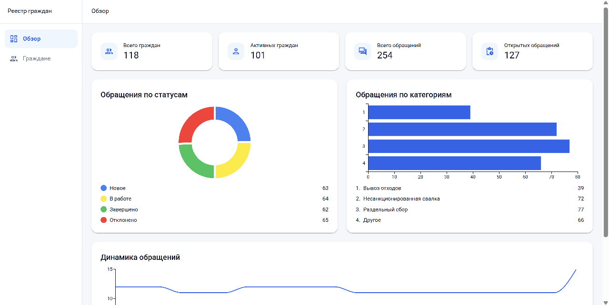
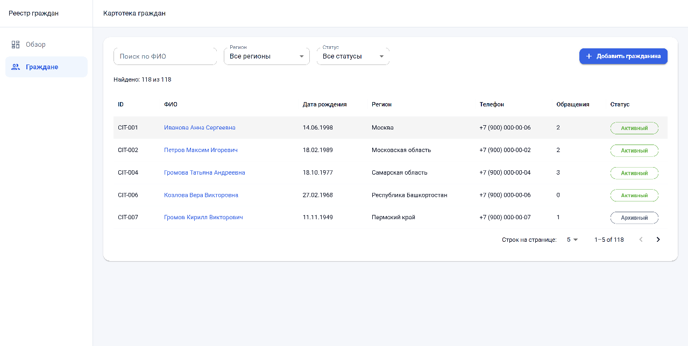
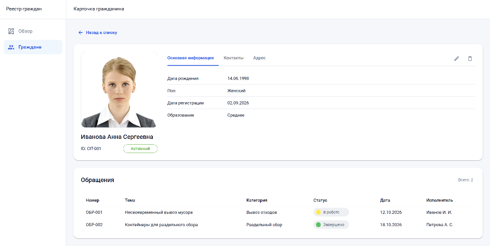
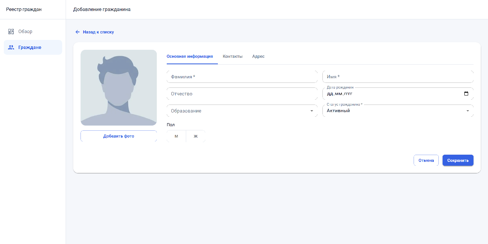
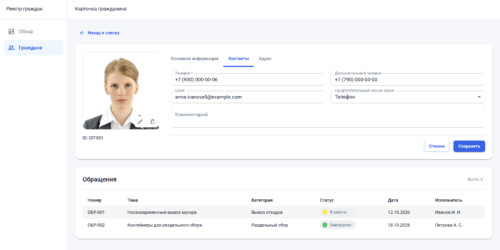

# Citizen Registry

Веб-приложение для ведения картотеки граждан и просмотра связанных обращений. Проект выполнен в рамках тестового задания для frontend-разработчика.

Интерфейс адаптируется под компьютеры, планшеты и телефоны.

### Обзор

Главная страница показывает показатели и графики по гражданам и обращениям.



### Картотека граждан

В картотеке доступны поиск по ФИО, фильтры по региону и статусу, сортировка и переход между страницами.



### Карточка гражданина

В карточке собраны основные сведения, контакты, адреса и связанные обращения. Карточку можно редактировать или удалить.



### Добавление и редактирование

При создании и редактировании можно заполнить данные и добавить фотографию. Форма проверяет поля и предупреждает о несохранённых изменениях.





## Технологии

JavaScript, React, Vite, React Router, Material UI и MUI X.

## Запуск

```bash
npm install
npm run dev
```

## Данные

Приложение использует вымышленные демонстрационные данные. Созданные и изменённые записи сохраняются в браузере, а фотографии — в IndexedDB. Сервер и база данных не подключены, поэтому данные доступны только в том браузере, где они были сохранены.

Описание полей находится в [docs/data-model.md](docs/data-model.md).
